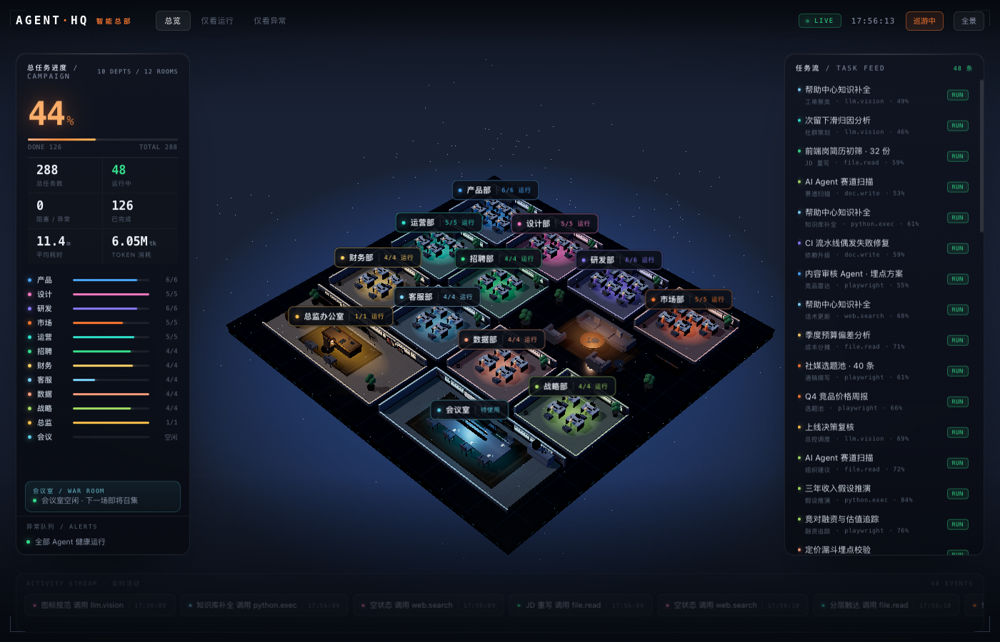

# AGENT HQ · 智能总部

等距 3D 办公楼形态的 Agent 监控大屏。房间 = 部门，工位 = Agent，地板光晕 / 屏幕亮灭 / 房间红灯对应实时任务状态。

**在线预览**：https://zhaoxinfeng619-hub.github.io/agent-hq/ （GitHub Pages，加载 `docs/index.html` 单文件，无需安装任何依赖）



12 个房间（10 业务部门 + 1 中庭 + 总监办公室 + 会议室），48 个 Agent。总监管全局，被叫去开会的人会离座走到会议室，散会再走回来。

不想克隆仓库？仓库里的 `docs/index.html` 就是完整的构建产物——**单个 HTML 文件，下载后双击即可离线打开**。

## 跑起来

```bash
npm install
npm run dev        # http://127.0.0.1:5273
```

生产构建（单文件 HTML，可直接双击打开）：

```bash
npm run build      # 产物 dist/index.html，约 757KB，three.js 已内联
```

**没有任何外部资源**：无 glb / 无 png，全部贴图与家具都由代码程序化生成，所以单文件可以离线双击打开。

## 交互

| 操作 | 效果 |
| --- | --- |
| 拖拽 | 旋转视角（方位角/俯仰角有限位） |
| 滚轮 | 缩放 |
| 点击房间 | 相机推近该房间，其他房间变暗，右侧任务流按部门过滤 |
| 点击工位 | 相机飞到该 Agent，弹出详情抽屉（任务进度、Token、会话流、重试） |
| 点击空白 | 回到全景 |
| 顶栏「巡游」 | 空闲时自动巡游到最活跃的房间 |
| 顶栏「全景」 | 复位视角并清除选中 |
| 左栏 chips / 房间条 | 按房间聚焦，再点一次取消 |

调试用 URL 参数：

| 参数 | 作用 |
| --- | --- |
| `?noboot=1` | 跳过开场 |
| `?noroam=1` | 不自动巡游 |
| `?focus=eng` | 聚焦某房间 |
| `?agent=eng-2` | 打开某 Agent 抽屉 |
| `?meet=1` | 立刻召集一场会议 |
| `?err=1` | 立刻注入一次异常 |
| `?noanim=1` | 跳过入场动画（截图用） |
| `?debug=1` | 左上角显示画质档位 / 帧时 / draw call / 三角面 / 会议状态 |
| `?pose=1` | 允许把参会人瞬移到座位（无头截图用，见下） |
| `?q=0\|1\|2` | 锁死画质档位（0 无泛光无阴影 / 1 无泛光 / 2 全开），验收截图用 |
| `?noshadow=1` | 只关阴影、保留泛光，排查阴影瑕疵用 |
| `?cam=theta,phi,radius,tx,ty,tz` | 直接落到指定机位（跳过缓动），无头截图取特写用 |

## 结构

```
src/
├─ scene/
│  ├─ HQScene.ts        # three.js 场景：灯光/墙体/家具/人形/光晕/行走/相机/拾取（不含业务逻辑）
│  ├─ geom.ts           # 自研几何合并器 mergeParts() + 家具搭建 DSL(Kit)
│  └─ textures.ts       # 全部程序化 Canvas 贴图 + 环境探针（带缓存）
├─ data/
│  ├─ types.ts          # 数据契约（Agent / Task / Ev / Meeting）
│  ├─ layout.ts         # 楼层几何、工位排布、会议席位（纯函数）
│  └─ world.ts          # Mock 世界引擎：任务推进、混沌注入、会议编排、统计
├─ store/useHQ.ts       # zustand：世界 → UI 的节流快照 + 交互状态
├─ components/          # Stage / TopBar / LeftPanel / TaskTable / Ticker / Drawer
└─ styles/ui.css        # 设计 token + 全部样式
```

关键约定：**3D 场景只读 `world` 的可变对象，每帧渲染；React 只以 ~2.4fps 拿快照**。
所以数据刷新频率不影响画面帧率，接真实数据源时只换 `world` 的事件来源，场景代码零改动。

## 三个机制

**故障模型（不是每帧掷骰子）**：`nextChaosAt` 每 36–68 秒调度一次故障注入，同时异常 Agent 上限 2 个，8–14 秒后自动恢复重试。这样大屏上永远能看到告警，但不会被红色淹没。

**会议编排**：每 42–72 秒召集一场，跨部门挑 3–4 人（总监六成概率到场主持），持续 15–21 秒。参会人 `status = 'meeting'`，任务进度冻结；散会时若原任务仍在跑就恢复，否则重新排队。

**行走路径**：`buildRoute()` 把人从工位引到所在排的前廊 → 中央通廊（x=0）→ 会议室。总监室右侧、会议室左侧刻意不建墙，通廊两侧连通，人是从开口走进去的，不是穿墙。

## 接真实数据（下一步）

`world.ts` 里的 `tick()` 目前是 Mock 随机游走。接真实 Agent 时：

1. 保留 `Agent / Task / Ev / Meeting` 结构，把 runtime 的原始日志（JSONL / SSE）归一成它们；
2. 用事件驱动代替 `tick()` 的随机推进：`task.start → running`、`tool.call → 当前工具`、`error → failed`、`agent.gather → meeting`；
3. 场景层与 UI 层都不用改。

## 材质与建模

没有美术资源，全部由代码生成，靠这三件事把低模做出"精模感"。

**贴图（`textures.ts`）**——都是离屏 Canvas 画完 `CanvasTexture` 出来，按 key 缓存只生成一次，随机数用 `mulberry32` 固定种子保证每次打开一样：

| 贴图 | 用途 |
| --- | --- |
| `carpetTexture` / `noiseTexture` | 部门地毯：方块拼缝 + 纤维噪声，同时当 `bumpMap` 与 `roughnessMap` |
| `laminateTexture` / `darkWoodTexture` | 工位台面 / 总监大班台与书墙 |
| `monitorTexture` | 工位屏：代码行 + 行号 + 光标，随机 8 种版面 |
| `bigScreenTexture` / `whiteboardTexture` | 总监指挥屏 / 会议室白板与墙面大屏 |
| `booksTexture` / `artTexture` | 书脊阵列 / 挂画 |
| `rugTexture` / `conferenceTexture` | 中庭地毯纹样 / 会议桌内嵌皮革 |
| `radialTexture` / `spriteTexture` / `bandTexture` / `gridTexture` | 地面光晕 / 呼吸光点 / 窗光带 / 底网格 |
| `makeEnvironment` | 程序化等距柱状环境图经 `PMREMGenerator` 烘成 `scene.environment`，金属与木作才有反射层次 |

**几何（`geom.ts`）**——`mergeParts()` 把几十个小体块烘成单个 `BufferGeometry`（自己拼 position/normal/uv，不引 `BufferGeometryUtils`，避免 Vite 依赖重优化把 dev server 搞崩）；`Kit` 提供 `box/cyl/ball/torus/slab/legs`，其中 `slab()` 生成带凸沿的台面——凸沿是"这不是盒子"的关键。`scaleUV()` 按世界尺寸缩放 UV，避免贴图被拉伸。

**光照与阴影**——ACES 色调映射 + 曝光 1.2；一盏主平行光 `(-16, 20, 12)` 开 2048 阴影（`PCFSoftShadowMap`，`normalBias 0.02` / `radius 2.4`）负责椅子桌子的落地投影，一盏补光 + 一盏轮廓光 + 半球光；墙体烘了顶点色垂直渐变（`0.74 + y·0.3`）近似 AO，顶部一条部门色亮边把 12 个房间读成整体而不是网格。

家具清单：工位每席 9 件配件（键盘/鼠标/屏框/支架/杯/纸/气压杆/五星脚/扶手），中庭是沙发休息区（三人沙发+抱枕+茶几+单人椅+落地灯+书架），总监办公室 20+ 件（大班台+皮革挡板+老板椅+三块弧形指挥屏+会客区+书墙+挂画），会议室是 8 席长桌+两条吊灯轨道+茶水柜。

> 人物仍是程序化胶囊体，等 Blender 模型接入后替换 `bodyMesh` / `headMesh`。

## 性能

| 项 | 做法 |
| --- | --- |
| Draw call | 实测 **172**（≈117k 三角面）。48 面墙 + 48 条亮边按材质合并成 InstancedMesh，矮柜/绿植/垃圾桶/会议桌腿等同类件各 1 个 InstancedMesh；原来 130+ 独立 mesh |
| 光源 | 1 主平行光（唯一投影源）+ 1 补光 + 1 轮廓光 + 环境/半球光；早先每个房间一盏点光会拖垮前向渲染 |
| 静态实例 | 桌/底座/屏/椅/椅背/全部家具矩阵只在初始化写一次（StaticDrawUsage），每帧只更新人形与头部 |
| 小件合并 | 桌面配件、办公椅底盘把手等用 `mergeParts()` 烘成单体几何，避免每件一个 draw call |
| 动态数据 | `world.deptLoad()` 带版本号缓存，3D 每帧读它不再产生任何数组分配（原先是每帧 2 次 × 30 个数组） |
| 后处理 | UnrealBloom 跑在 0.7 分辨率上 |
| 分辨率 | dpr 上限 1.5，按帧时自动降档：>26ms → dpr 1.1，>33ms → 关泛光并关阴影、dpr 1 |
| 统计 | `renderer.info.autoReset = false` + 每帧 `reset()`，`?debug=1` 面板里的 draw/tri 是真实值而不是 1 |
| 标签 | 房间悬浮标签每 2 帧更新一次（省一半 DOM 写入） |

降档逻辑在 `checkPerf() / applyQuality()`，跳过前 2 个采样窗口避免着色器编译误判。

## 无头截图注意

本机 Chrome `--headless=new` + `--virtual-time-budget` 下 **requestAnimationFrame 几乎不推进**，`clock.getDelta()` 返回 0，所以行走/脉冲这类逐帧动画截不到。为此：

- `tick` 里给 dt 加了 4ms 下限，避免真实低帧率设备上动画卡死；
- `?pose=1` 可把参会人直接瞬移到座位，用来验证入座姿态；
- `?noanim=1` 跳过 CSS 入场动画，否则面板可能截成 opacity 0。
